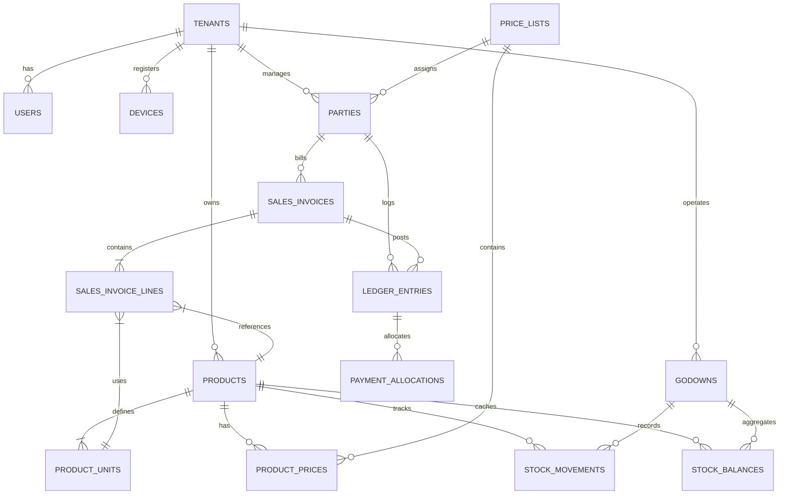

# Hardware Billing OS — Master Data Model Specification
**Version:** 1.0.0 (Locked for v1)  
**Target RDBMS:** PostgreSQL 16  
**Architecture:** Shared Schema with Multi-tenant `tenant_id` + Row-Level Security (RLS)  

---

## 1. Architectural Principles & Isolation

1. **Multi-Tenancy via PostgreSQL RLS**: Every business table contains `tenant_id UUID NOT NULL REFERENCES tenants(id) ON DELETE RESTRICT`. All queries run under a PostgreSQL session setting:
   ```sql
   SET LOCAL app.current_tenant_id = 'tenant-uuid-here';
   ```
   Policies enforce:
   ```sql
   CREATE POLICY tenant_isolation_policy ON <table>
     USING (tenant_id = NULLIF(current_setting('app.current_tenant_id', true), '')::uuid);
   ```
2. **Immutable Financial and Stock Ledgers**: `stock_movements` and `ledger_entries` are strictly **append-only**. Invoices, receipts, and returns are never updated or deleted once posted. Corrections require a credit note, debit note, or stock adjustment.
3. **Unit Math Invariant**: Stock is stored **strictly in base units** as `NUMERIC(18, 4)`. Mixed unit representations (e.g., "9 boxes 63 pcs") are computed view layers. Money calculations round only at the line total level (2 decimals).
4. **Offline Sync & Reserved Series**: Counter desktop apps bill offline using SQLite, drawing sequence numbers from pre-reserved blocks (e.g. `C1/2026-27/0001` through `C1/2026-27/0999`).

---

## 2. Entity Relationship Diagram (Core Modules)



---

## 3. Data Dictionary & Table Definitions

### 3.1 Tenant & System Configuration

```sql
-- 1. tenants
CREATE TABLE tenants (
    id UUID PRIMARY KEY DEFAULT gen_random_uuid(),
    business_name VARCHAR(255) NOT NULL,
    trade_name VARCHAR(255),
    gstin VARCHAR(15),
    phone VARCHAR(15) NOT NULL,
    email VARCHAR(255),
    address_line1 TEXT NOT NULL,
    address_line2 TEXT,
    city VARCHAR(100) NOT NULL,
    state_code VARCHAR(2) NOT NULL DEFAULT '33', -- 33 = Tamil Nadu
    pincode VARCHAR(10) NOT NULL,
    currency VARCHAR(5) NOT NULL DEFAULT 'INR',
    is_active BOOLEAN NOT NULL DEFAULT TRUE,
    created_at TIMESTAMPTZ NOT NULL DEFAULT NOW(),
    updated_at TIMESTAMPTZ NOT NULL DEFAULT NOW()
);

-- 2. devices (Billing counter nodes)
CREATE TABLE devices (
    id UUID PRIMARY KEY DEFAULT gen_random_uuid(),
    tenant_id UUID NOT NULL REFERENCES tenants(id),
    device_code VARCHAR(20) NOT NULL, -- e.g. 'COUNTER-1', 'COUNTER-2'
    device_name VARCHAR(100) NOT NULL,
    device_fingerprint VARCHAR(255) NOT NULL,
    is_counter BOOLEAN NOT NULL DEFAULT TRUE,
    is_active BOOLEAN NOT NULL DEFAULT TRUE,
    last_sync_at TIMESTAMPTZ,
    created_at TIMESTAMPTZ NOT NULL DEFAULT NOW(),
    CONSTRAINT uq_device_tenant_code UNIQUE (tenant_id, device_code)
);

-- 3. number_series (Pre-allocated and server document sequences)
CREATE TABLE number_series (
    id UUID PRIMARY KEY DEFAULT gen_random_uuid(),
    tenant_id UUID NOT NULL REFERENCES tenants(id),
    device_id UUID REFERENCES devices(id), -- NULL for centralized server series
    doc_type VARCHAR(50) NOT NULL, -- 'SALES_INVOICE', 'QUOTATION', 'CHALLAN', 'CREDIT_NOTE', 'PURCHASE_BILL'
    financial_year VARCHAR(10) NOT NULL, -- e.g. '2026-27'
    prefix VARCHAR(30) NOT NULL, -- e.g. 'C1/26-27/', 'POS/26-27/'
    current_number BIGINT NOT NULL DEFAULT 0,
    range_start BIGINT NOT NULL DEFAULT 1,
    range_end BIGINT NOT NULL DEFAULT 999999,
    created_at TIMESTAMPTZ NOT NULL DEFAULT NOW(),
    updated_at TIMESTAMPTZ NOT NULL DEFAULT NOW(),
    CONSTRAINT uq_number_series UNIQUE (tenant_id, device_id, doc_type, financial_year)
);
```

---

### 3.2 Catalogue & Smart Unit Conversion

```sql
-- 4. categories & brands
CREATE TABLE categories (
    id UUID PRIMARY KEY DEFAULT gen_random_uuid(),
    tenant_id UUID NOT NULL REFERENCES tenants(id),
    name VARCHAR(100) NOT NULL,
    parent_id UUID REFERENCES categories(id),
    is_active BOOLEAN NOT NULL DEFAULT TRUE,
    CONSTRAINT uq_category_tenant_name UNIQUE (tenant_id, name)
);

CREATE TABLE brands (
    id UUID PRIMARY KEY DEFAULT gen_random_uuid(),
    tenant_id UUID NOT NULL REFERENCES tenants(id),
    name VARCHAR(100) NOT NULL,
    is_active BOOLEAN NOT NULL DEFAULT TRUE,
    CONSTRAINT uq_brand_tenant_name UNIQUE (tenant_id, name)
);

-- 5. products (Base items)
CREATE TABLE products (
    id UUID PRIMARY KEY DEFAULT gen_random_uuid(),
    tenant_id UUID NOT NULL REFERENCES tenants(id),
    code VARCHAR(50) NOT NULL,
    name VARCHAR(255) NOT NULL,
    tamil_name VARCHAR(255), -- Support for native Tamil search & billing
    category_id UUID REFERENCES categories(id),
    brand_id UUID REFERENCES brands(id),
    hsn_code VARCHAR(8) NOT NULL,
    base_unit VARCHAR(20) NOT NULL, -- 'piece', 'kg', 'metre', 'sqft', 'litre'
    is_variable_weight BOOLEAN NOT NULL DEFAULT FALSE, -- e.g. TMT bars, steel sheets
    min_stock_base NUMERIC(18, 4) NOT NULL DEFAULT 0,
    reorder_quantity_base NUMERIC(18, 4) NOT NULL DEFAULT 0,
    purchase_price_base NUMERIC(14, 4) NOT NULL DEFAULT 0, -- Latest purchase cost per base unit
    is_active BOOLEAN NOT NULL DEFAULT TRUE,
    created_at TIMESTAMPTZ NOT NULL DEFAULT NOW(),
    updated_at TIMESTAMPTZ NOT NULL DEFAULT NOW(),
    CONSTRAINT uq_product_tenant_code UNIQUE (tenant_id, code)
);

CREATE INDEX idx_products_search ON products (tenant_id, name, tamil_name, code);

-- 6. product_units (Unit conversion mapping)
CREATE TABLE product_units (
    id UUID PRIMARY KEY DEFAULT gen_random_uuid(),
    tenant_id UUID NOT NULL REFERENCES tenants(id),
    product_id UUID NOT NULL REFERENCES products(id) ON DELETE CASCADE,
    unit_name VARCHAR(30) NOT NULL, -- e.g. 'Box', 'Coil', 'Rod', 'Bundle', 'Tonne'
    conversion_factor NUMERIC(18, 6) NOT NULL, -- e.g. 1 Box = 100 pcs -> factor = 100.000000
    can_buy BOOLEAN NOT NULL DEFAULT TRUE,
    can_sell BOOLEAN NOT NULL DEFAULT TRUE,
    barcode VARCHAR(64),
    is_default_sales_unit BOOLEAN NOT NULL DEFAULT FALSE,
    is_default_purchase_unit BOOLEAN NOT NULL DEFAULT FALSE,
    created_at TIMESTAMPTZ NOT NULL DEFAULT NOW(),
    CONSTRAINT uq_product_unit UNIQUE (tenant_id, product_id, unit_name)
);

CREATE INDEX idx_product_units_barcode ON product_units (tenant_id, barcode) WHERE barcode IS NOT NULL;

-- 7. price_lists & product_prices (Contractor/Wholesale/Retail pricing)
CREATE TABLE price_lists (
    id UUID PRIMARY KEY DEFAULT gen_random_uuid(),
    tenant_id UUID NOT NULL REFERENCES tenants(id),
    code VARCHAR(30) NOT NULL, -- 'RETAIL', 'WHOLESALE', 'CONTRACTOR'
    name VARCHAR(100) NOT NULL,
    is_default BOOLEAN NOT NULL DEFAULT FALSE,
    created_at TIMESTAMPTZ NOT NULL DEFAULT NOW(),
    CONSTRAINT uq_pricelist_tenant_code UNIQUE (tenant_id, code)
);

CREATE TABLE product_prices (
    id UUID PRIMARY KEY DEFAULT gen_random_uuid(),
    tenant_id UUID NOT NULL REFERENCES tenants(id),
    product_id UUID NOT NULL REFERENCES products(id) ON DELETE CASCADE,
    unit_name VARCHAR(30) NOT NULL,
    price_list_id UUID NOT NULL REFERENCES price_lists(id) ON DELETE CASCADE,
    price NUMERIC(12, 2) NOT NULL,
    min_allowed_price NUMERIC(12, 2), -- Floor restriction for POS clerk
    effective_from TIMESTAMPTZ NOT NULL DEFAULT NOW(),
    effective_to TIMESTAMPTZ,
    CONSTRAINT uq_product_prices_active UNIQUE (tenant_id, product_id, unit_name, price_list_id, effective_from)
);
```

---

### 3.3 Inventory & Stock Ledger

```sql
-- 8. godowns
CREATE TABLE godowns (
    id UUID PRIMARY KEY DEFAULT gen_random_uuid(),
    tenant_id UUID NOT NULL REFERENCES tenants(id),
    code VARCHAR(30) NOT NULL,
    name VARCHAR(100) NOT NULL,
    is_primary BOOLEAN NOT NULL DEFAULT FALSE,
    is_active BOOLEAN NOT NULL DEFAULT TRUE,
    CONSTRAINT uq_godown_tenant_code UNIQUE (tenant_id, code)
);

-- 9. stock_movements (Strictly Append-Only Ledger)
CREATE TABLE stock_movements (
    id UUID PRIMARY KEY DEFAULT gen_random_uuid(),
    tenant_id UUID NOT NULL REFERENCES tenants(id),
    godown_id UUID NOT NULL REFERENCES godowns(id),
    product_id UUID NOT NULL REFERENCES products(id),
    movement_type VARCHAR(30) NOT NULL, 
    -- 'PURCHASE', 'SALE', 'SALES_RETURN', 'PURCHASE_RETURN', 'ADJUSTMENT_IN', 'ADJUSTMENT_OUT', 'TRANSFER_IN', 'TRANSFER_OUT', 'OPENING'
    quantity_base NUMERIC(18, 4) NOT NULL, -- Positive for IN, Negative for OUT
    unit_cost_base NUMERIC(18, 4) NOT NULL, -- Weighted average or purchase cost in base unit
    reference_doc_type VARCHAR(50) NOT NULL, -- 'SALES_INVOICE', 'PURCHASE_BILL', 'STOCK_ADJUSTMENT', etc.
    reference_doc_id UUID NOT NULL,
    reference_doc_number VARCHAR(60) NOT NULL,
    created_at TIMESTAMPTZ NOT NULL DEFAULT NOW(),
    created_by UUID
);

CREATE INDEX idx_stock_movements_prod_date ON stock_movements (tenant_id, product_id, created_at DESC);

-- 10. stock_balances (Fast real-time read cache, updated synchronously via DB trigger / service transaction)
CREATE TABLE stock_balances (
    id UUID PRIMARY KEY DEFAULT gen_random_uuid(),
    tenant_id UUID NOT NULL REFERENCES tenants(id),
    godown_id UUID NOT NULL REFERENCES godowns(id),
    product_id UUID NOT NULL REFERENCES products(id),
    current_quantity_base NUMERIC(18, 4) NOT NULL DEFAULT 0,
    weighted_avg_cost_base NUMERIC(18, 4) NOT NULL DEFAULT 0,
    last_movement_at TIMESTAMPTZ NOT NULL DEFAULT NOW(),
    CONSTRAINT uq_stock_balance UNIQUE (tenant_id, godown_id, product_id)
);

CREATE INDEX idx_stock_balances_low_stock ON stock_balances (tenant_id, current_quantity_base);
```

---

### 3.4 Customer & Supplier Ledger

```sql
-- 11. parties
CREATE TABLE parties (
    id UUID PRIMARY KEY DEFAULT gen_random_uuid(),
    tenant_id UUID NOT NULL REFERENCES tenants(id),
    party_type VARCHAR(20) NOT NULL, -- 'CUSTOMER', 'SUPPLIER', 'BOTH'
    name VARCHAR(255) NOT NULL,
    phone VARCHAR(15),
    email VARCHAR(100),
    gstin VARCHAR(15),
    state_code VARCHAR(2) NOT NULL DEFAULT '33', -- State for GST (Tamil Nadu = 33)
    billing_address TEXT,
    price_list_id UUID REFERENCES price_lists(id),
    credit_limit NUMERIC(14, 2) NOT NULL DEFAULT 0.00,
    credit_days INT NOT NULL DEFAULT 0,
    opening_balance NUMERIC(14, 2) NOT NULL DEFAULT 0.00, -- Positive = owes us, Negative = advance
    current_balance NUMERIC(14, 2) NOT NULL DEFAULT 0.00,
    is_active BOOLEAN NOT NULL DEFAULT TRUE,
    created_at TIMESTAMPTZ NOT NULL DEFAULT NOW(),
    updated_at TIMESTAMPTZ NOT NULL DEFAULT NOW()
);

CREATE INDEX idx_parties_phone_name ON parties (tenant_id, phone, name);

-- 12. ledger_entries (Strictly Append-Only Accounting Ledger)
CREATE TABLE ledger_entries (
    id UUID PRIMARY KEY DEFAULT gen_random_uuid(),
    tenant_id UUID NOT NULL REFERENCES tenants(id),
    party_id UUID NOT NULL REFERENCES parties(id),
    entry_type VARCHAR(40) NOT NULL,
    -- 'SALES_INVOICE', 'PAYMENT_RECEIPT', 'SALES_RETURN_CREDIT_NOTE', 'PURCHASE_BILL', 'SUPPLIER_PAYMENT', 'PURCHASE_RETURN_DEBIT_NOTE', 'OPENING_BALANCE', 'ADJUSTMENT'
    debit_amount NUMERIC(14, 2) NOT NULL DEFAULT 0.00, -- Debit: increases what customer owes us
    credit_amount NUMERIC(14, 2) NOT NULL DEFAULT 0.00, -- Credit: decreases what customer owes us (receipt)
    reference_doc_type VARCHAR(50) NOT NULL,
    reference_doc_id UUID NOT NULL,
    reference_doc_number VARCHAR(60) NOT NULL,
    entry_date DATE NOT NULL DEFAULT CURRENT_DATE,
    notes TEXT,
    created_at TIMESTAMPTZ NOT NULL DEFAULT NOW(),
    created_by UUID
);

CREATE INDEX idx_ledger_party_entries ON ledger_entries (tenant_id, party_id, entry_date DESC);

-- 13. payment_allocations (Bill-wise aging & settlement)
CREATE TABLE payment_allocations (
    id UUID PRIMARY KEY DEFAULT gen_random_uuid(),
    tenant_id UUID NOT NULL REFERENCES tenants(id),
    payment_entry_id UUID NOT NULL REFERENCES ledger_entries(id) ON DELETE RESTRICT,
    invoice_entry_id UUID NOT NULL REFERENCES ledger_entries(id) ON DELETE RESTRICT,
    allocated_amount NUMERIC(14, 2) NOT NULL,
    created_at TIMESTAMPTZ NOT NULL DEFAULT NOW()
);

CREATE INDEX idx_payment_allocations_inv ON payment_allocations (tenant_id, invoice_entry_id);
```

---

### 3.5 Sales & POS Billing

```sql
-- 14. sales_invoices
CREATE TABLE sales_invoices (
    id UUID PRIMARY KEY DEFAULT gen_random_uuid(),
    tenant_id UUID NOT NULL REFERENCES tenants(id),
    device_id UUID REFERENCES devices(id),
    invoice_number VARCHAR(60) NOT NULL,
    invoice_date TIMESTAMPTZ NOT NULL DEFAULT NOW(),
    party_id UUID REFERENCES parties(id), -- NULL for retail walk-in
    customer_name VARCHAR(255) NOT NULL,
    customer_phone VARCHAR(15),
    customer_gstin VARCHAR(15),
    place_of_supply_state_code VARCHAR(2) NOT NULL DEFAULT '33',
    is_b2b BOOLEAN NOT NULL DEFAULT FALSE,
    price_list_id UUID NOT NULL REFERENCES price_lists(id),
    godown_id UUID NOT NULL REFERENCES godowns(id),
    status VARCHAR(20) NOT NULL DEFAULT 'POSTED', -- 'DRAFT', 'POSTED', 'CANCELLED'
    subtotal_amount NUMERIC(14, 2) NOT NULL,
    discount_amount NUMERIC(14, 2) NOT NULL DEFAULT 0.00,
    cgst_amount NUMERIC(14, 2) NOT NULL DEFAULT 0.00,
    sgst_amount NUMERIC(14, 2) NOT NULL DEFAULT 0.00,
    igst_amount NUMERIC(14, 2) NOT NULL DEFAULT 0.00,
    total_tax_amount NUMERIC(14, 2) NOT NULL DEFAULT 0.00,
    round_off_amount NUMERIC(6, 2) NOT NULL DEFAULT 0.00,
    grand_total NUMERIC(14, 2) NOT NULL,
    paid_amount NUMERIC(14, 2) NOT NULL DEFAULT 0.00,
    due_amount NUMERIC(14, 2) NOT NULL DEFAULT 0.00,
    payment_mode VARCHAR(20) NOT NULL, -- 'CASH', 'UPI', 'CARD', 'CREDIT', 'SPLIT'
    payment_breakdown JSONB, -- e.g. [{"mode": "CASH", "amount": 500}, {"mode": "UPI", "amount": 1250, "ref": "..."}]
    upi_qr_string TEXT,
    is_offline_created BOOLEAN NOT NULL DEFAULT FALSE,
    offline_created_at TIMESTAMPTZ,
    synced_at TIMESTAMPTZ,
    created_at TIMESTAMPTZ NOT NULL DEFAULT NOW(),
    created_by UUID,
    CONSTRAINT uq_sales_invoice_number UNIQUE (tenant_id, invoice_number)
);

CREATE INDEX idx_sales_invoices_date ON sales_invoices (tenant_id, invoice_date DESC);
CREATE INDEX idx_sales_invoices_party ON sales_invoices (tenant_id, party_id);

-- 15. sales_invoice_lines
CREATE TABLE sales_invoice_lines (
    id UUID PRIMARY KEY DEFAULT gen_random_uuid(),
    tenant_id UUID NOT NULL REFERENCES tenants(id),
    invoice_id UUID NOT NULL REFERENCES sales_invoices(id) ON DELETE CASCADE,
    line_number INT NOT NULL,
    product_id UUID NOT NULL REFERENCES products(id),
    unit_name VARCHAR(30) NOT NULL,
    conversion_factor NUMERIC(18, 6) NOT NULL,
    quantity NUMERIC(18, 4) NOT NULL,
    actual_weight_kg NUMERIC(18, 4), -- Optional weighed kg for variable-weight items (TMT, sheets)
    base_quantity NUMERIC(18, 4) NOT NULL, -- Exact quantity moved from stock in base units
    unit_price NUMERIC(12, 2) NOT NULL,
    cost_price_base_at_sale NUMERIC(14, 4) NOT NULL, -- For exact gross margin calculation
    discount_type VARCHAR(10) NOT NULL DEFAULT 'FLAT', -- 'PERCENT' or 'FLAT'
    discount_value NUMERIC(12, 2) NOT NULL DEFAULT 0.00,
    discount_amount NUMERIC(12, 2) NOT NULL DEFAULT 0.00,
    taxable_amount NUMERIC(14, 2) NOT NULL,
    hsn_code VARCHAR(8) NOT NULL,
    gst_rate_percent NUMERIC(5, 2) NOT NULL,
    cgst_percent NUMERIC(5, 2) NOT NULL DEFAULT 0.00,
    cgst_amount NUMERIC(12, 2) NOT NULL DEFAULT 0.00,
    sgst_percent NUMERIC(5, 2) NOT NULL DEFAULT 0.00,
    sgst_amount NUMERIC(12, 2) NOT NULL DEFAULT 0.00,
    igst_percent NUMERIC(5, 2) NOT NULL DEFAULT 0.00,
    igst_amount NUMERIC(12, 2) NOT NULL DEFAULT 0.00,
    line_total NUMERIC(14, 2) NOT NULL,
    CONSTRAINT uq_invoice_line_num UNIQUE (tenant_id, invoice_id, line_number)
);
```

---

## 4. Integrity Constraints & Invariants

| Invariant | Enforced By | Description |
|---|---|---|
| **Stock Consistency** | Trigger / App Layer | `stock_balances.current_quantity_base = SUM(stock_movements.quantity_base)` |
| **Ledger Consistency** | Trigger / Nightly Job | `parties.current_balance = SUM(ledger_entries.debit_amount) - SUM(ledger_entries.credit_amount) + opening_balance` |
| **Aging Consistency** | DB Foreign Keys | `SUM(payment_allocations.allocated_amount) <= payment_entry.credit_amount` |
| **GST Place of Supply** | Line Calculation Rule | If `party.state_code == tenant.state_code`, apply `CGST + SGST (each = gst_rate / 2)`. If different, apply `IGST (= gst_rate)`. |
| **Unit Base Stock** | `product_units.conversion_factor` | `line.base_quantity = line.quantity * line.conversion_factor` (or `line.actual_weight_kg` if variable weight). |
